# Azure IAM Sandbox + Microsoft Sentinel Honeypot

A hands-on cloud security lab that combines an **identity and access management (IAM) sandbox in Microsoft Entra ID** with an **internet-exposed Windows honeypot monitored by Microsoft Sentinel**. Identity events and real-world attack telemetry flow into one SIEM, where they are investigated, mapped to MITRE ATT&CK, and turned into detections.

Built to put **AZ-900** and **SC-900** concepts into practice.

> **Headline result:** over ~4 days the honeypot received **431,732 failed logons from 130 IP addresses in 31 countries**. **No attacker authenticated.** Nearly 99% of attempts targeted accounts that do not exist on the host.

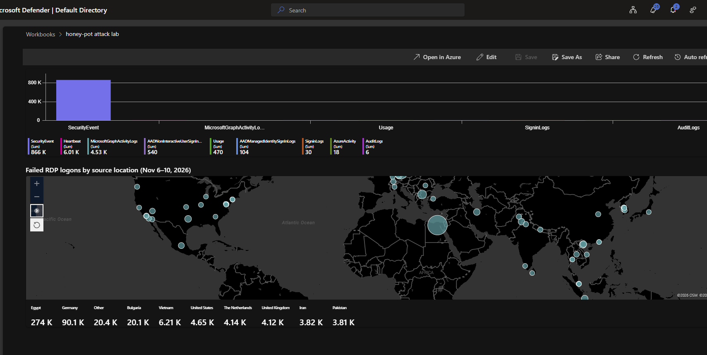

---

## Contents
1. [Architecture](#architecture)
2. [Identity & access controls](#identity--access-controls)
3. [Honeypot: data collected](#honeypot-data-collected)
4. [Key findings](#key-findings)
5. [Detections](#detections)
6. [Hardening](#hardening)
7. [Lessons learned](#lessons-learned)
8. [Limitations](#limitations)
9. [Exam objective mapping](#exam-objective-mapping)
10. [Evidence files](#evidence-files)

---

## Architecture

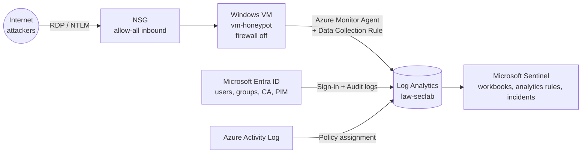

| Component | Configuration |
|---|---|
| Resource group | `rg-seclab` (East US), scoped budget alert |
| Governance | Azure Policy **Allowed locations** (East US only), effect *Deny*. Verified by attempting a West Europe deployment (below) |
| Honeypot VM | Windows, `Standard_D2as_v4`, NSG inbound **Any/Any**, Windows Firewall disabled, non-default admin name, long random password |
| Logging | Security Events via Azure Monitor Agent; audit policy *Logon: Success and Failure* |
| SIEM | Microsoft Sentinel on `law-seclab` with 4 data sources: `SecurityEvent`, `SigninLogs`, `AuditLogs`, `AzureActivity` |

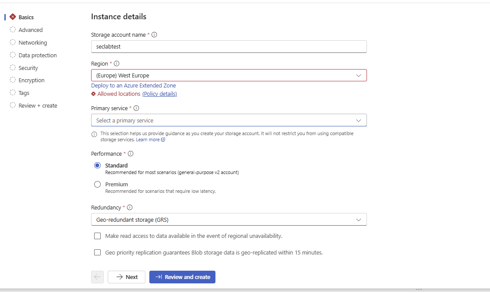
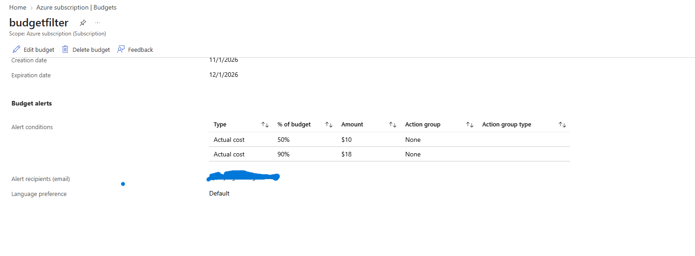

---

## Identity & access controls

A fictional company, **Ridgeline Logistics**, with 4 departments and least-privilege access.

### Users and Azure RBAC

| Group | Members | Azure role | Scope | Intent |
|---|---|---|---|---|
| IT-Admins | Alex Chen, Jordan Patel | Contributor | `rg-seclab` | Manage resources, cannot grant access |
| HR | Sam Rivera, Taylor Brooks | Reader | `rg-seclab` | View only |
| Finance | Morgan Lee, Casey Nguyen | Cost Management Reader | Subscription | See spending only |
| Contractors | Riley Ortiz | **Lab VM Operator** (custom) | `rg-seclab` | Start, restart, stop VMs and nothing else |

Plus a **Break Glass** emergency Global Administrator, excluded from every Conditional Access policy.

<details>
<summary>Custom role definition: Lab VM Operator</summary>

```json
{
  "Name": "Lab VM Operator",
  "Description": "Start, restart and stop VMs in rg-seclab. Nothing else.",
  "Actions": [
    "Microsoft.Compute/virtualMachines/read",
    "Microsoft.Compute/virtualMachines/start/action",
    "Microsoft.Compute/virtualMachines/restart/action",
    "Microsoft.Compute/virtualMachines/deallocate/action",
    "Microsoft.Resources/subscriptions/resourceGroups/read"
  ],
  "NotActions": [],
  "AssignableScopes": ["/subscriptions/<sub-id>/resourceGroups/rg-seclab"]
}
```
</details>

**Least privilege, tested rather than assumed:**
- **Sam Rivera (Reader)** tried to create a storage account → **denied** (authorization failure).
- **Riley Ortiz (Lab VM Operator)** restarted the VM → **allowed**. Viewing networking → **denied (401)**.

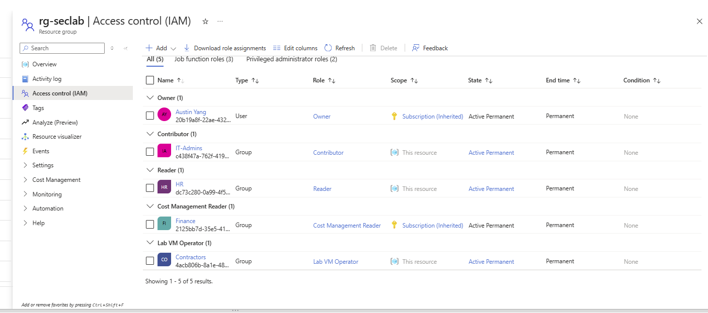
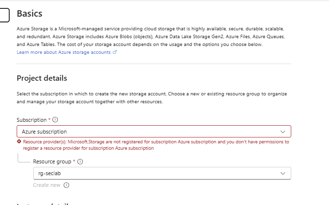
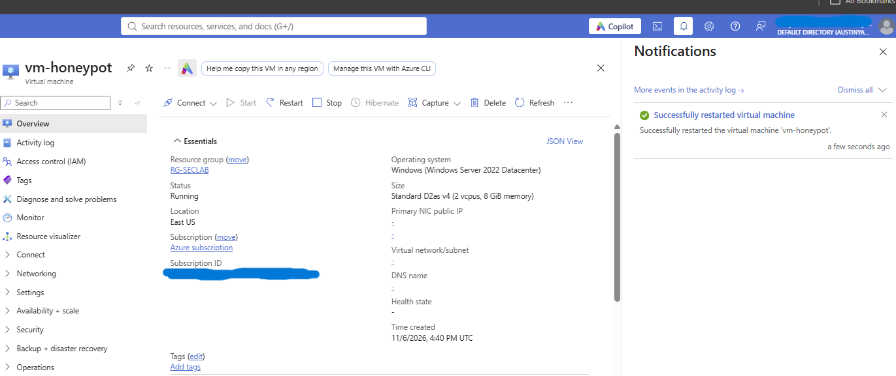
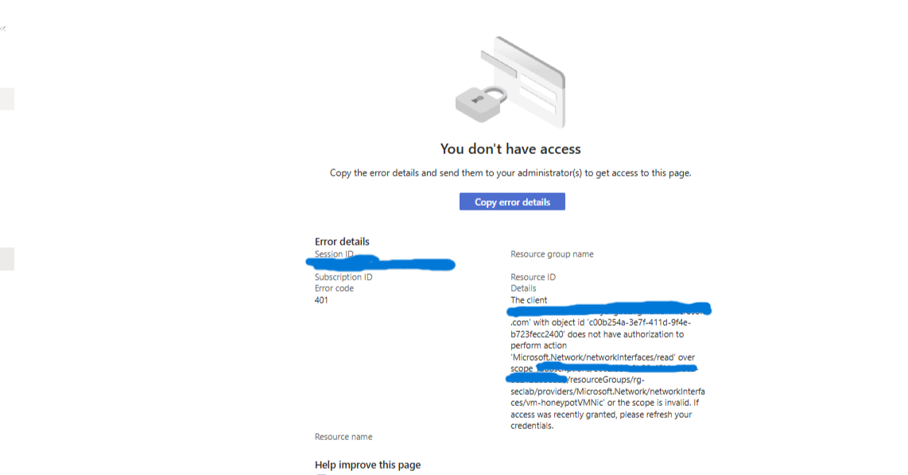

### Conditional Access

Security defaults were disabled and replaced with four policies, rolled out **Report-only first**, then enforced where safe.

| Policy | Targets | Condition | Control | State |
|---|---|---|---|---|
| `CA01-MFA-Admins` | Global, User, Privileged Role Admins | All resources | Require MFA | **On** |
| `CA02-Block-Legacy-Auth` | All users | Exchange ActiveSync, other clients | Block | **On** |
| `CA03-Block-Countries` | All users (excl. break glass + tenant admin) | Named location "Blocked countries" | Block | Report-only |
| `CA04-Risky-Signin` | All users | Sign-in risk Medium/High | MFA + sign-in frequency every time | Report-only |

**What If test:** Sam Rivera signing in from a blocked country, using the IP of a real honeypot attacker (`189.223.183.200`, Mexico) → `CA03-Block-Countries` applies → **Block**.

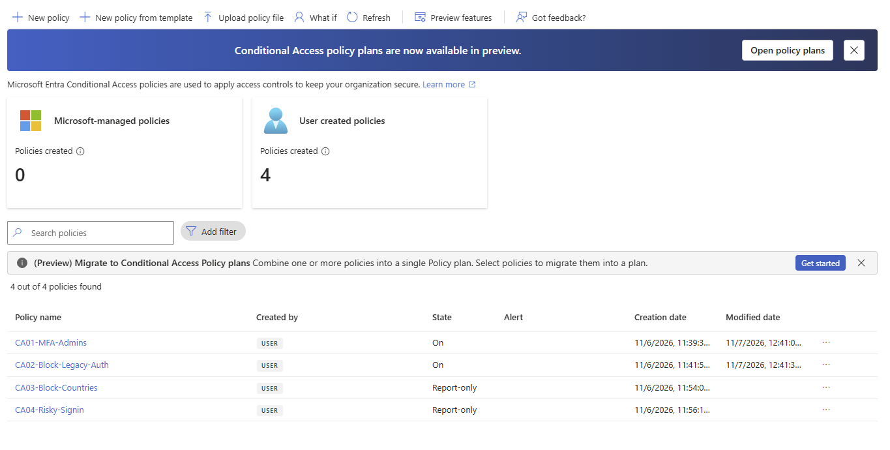
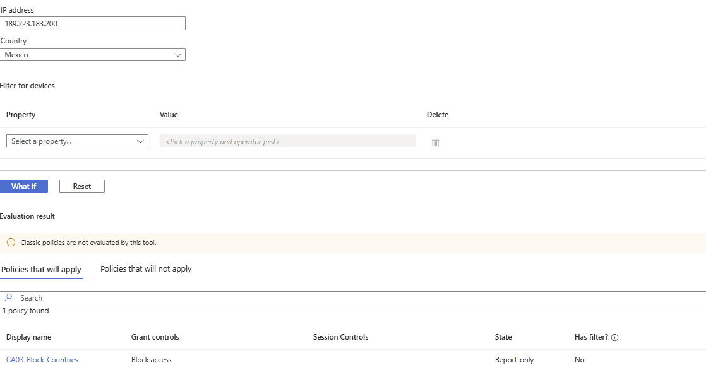

### Privileged Identity Management (just-in-time access)

| Assignment | Type | Settings |
|---|---|---|
| Jordan Patel → **User Administrator** (Entra role) | Eligible | 1-hour max, justification required, **approval required** (approver: Tenant Admin) |
| Alex Chen → **Owner** on `rg-seclab` (Azure role) | Eligible | 1-year eligibility (permanent eligibility disallowed by default) |

**Simulation:** Jordan requested activation, Tenant Admin approved it, and the role expired automatically after 1 hour. The full chain was captured in `AuditLogs`:

| Time (UTC) | Event | Actor |
|---|---|---|
| 05:24:53 | Activation requested | Jordan Patel |
| 05:24:55 | Approval requested | Jordan Patel |
| 05:28:00 | **Request approved** | **Tenant Admin** |
| 05:28:01 | Role granted | MS-PIM (service) |
| 05:28:07 | Activation completed | Jordan Patel |

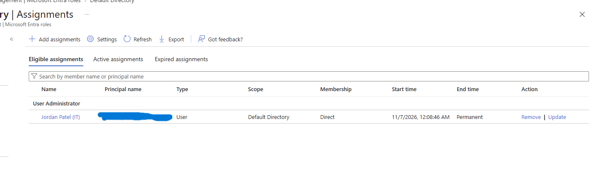
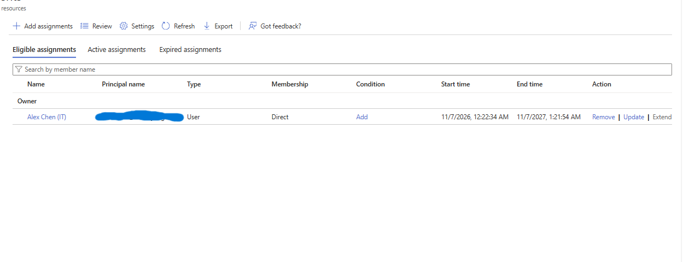
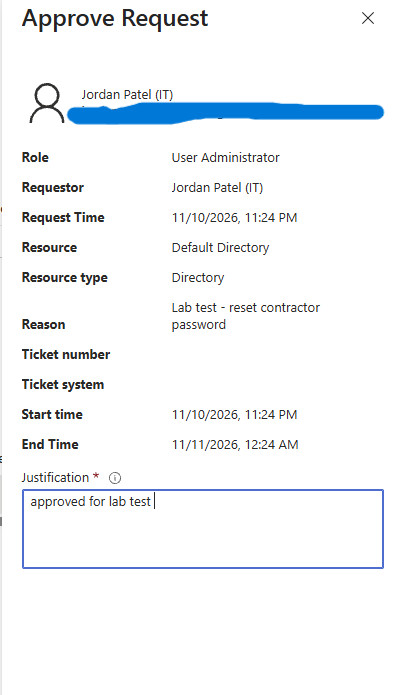
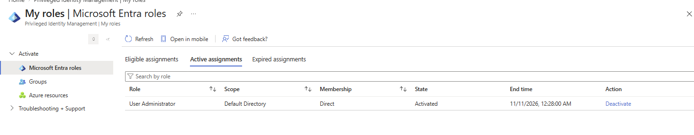
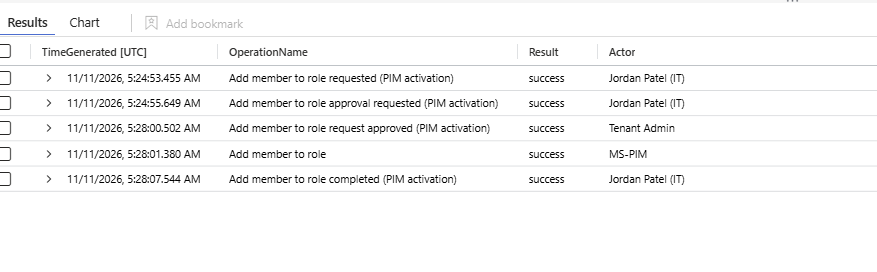

> **Lesson:** a Global Administrator in Entra ID had **no visibility into Azure resources** in PIM until it was granted an Azure RBAC role. Entra directory roles and Azure RBAC are separate permission systems.

---

## Honeypot: data collected

| Metric | Value |
|---|---|
| Exposure window | 2026-11-06 → 2026-11-10 (~4 days) |
| Failed logons (4625) | **431,732** |
| NTLM credential validations (4776) | 427,163 (≈1:1 with 4625) |
| Unique source IPs | **130** |
| Countries | **31** |
| Peak hour | 8,622 attempts (2026-11-10 18:00 UTC) |
| Peak concurrent sources | 35 IPs in one hour |
| Account lockouts (4740) | 1 (built-in `Guest`) |
| Successful attacker logons | **0** |

### Top countries

| Country | Attempts | Source IPs | Share |
|---|---:|---:|---:|
| Egypt | 274,399 | 1 | 63.6% |
| Germany | 91,537 | 8 | 21.2% |
| Bulgaria | 20,062 | 3 | 4.6% |
| Vietnam | 9,377 | 11 | 2.2% |
| United States | 7,106 | 32 | 1.6% |

The United States had the **most source IPs (32)** but contributed only 1.6% of attempts: many sources, each sending very little.

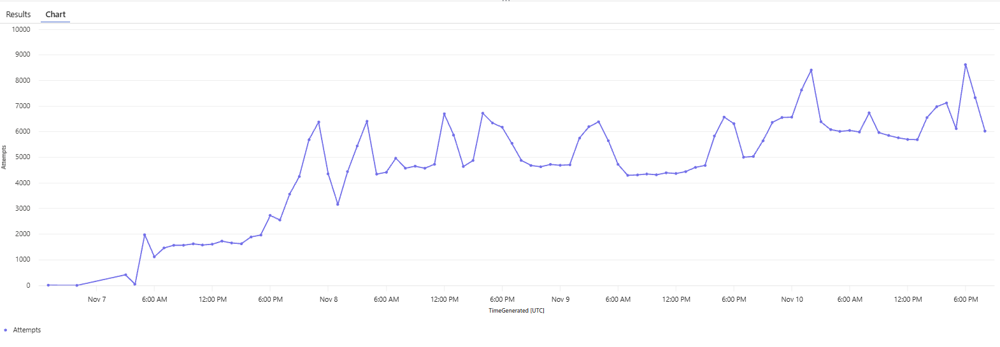

### What attackers guessed

| Username | Attempts | Notes |
|---|---:|---|
| `User`, `accounts`, `for`, `\\` | ~65,000 each | Malformed wordlist (see Finding 3) |
| `Administrator` / `administrator` | 45,252 | Tried by 98 + 17 different IPs |
| `Admin` / `admin` | 25,690 | |
| `user`, `server`, `support`, `test`, `remote` | 10,700–15,800 each | |
| `ADMINISTRATEUR`, `АДМИНИСТРАТОР`, `ADMINISTRADOR` | ~1,500 each | Localized admin names (FR, RU, ES/PT) |
| `azureuser` | 925 | Default admin name in many Azure templates |

**98.9%** of attempts returned `0xC0000064` (*user does not exist*). About 1% were blank-username probes. Only ~30 attempts hit an account that exists (`Guest`, `DefaultAccount`), and both are disabled by default.

---

## Key findings

### 1. One government-registered IP produced 64% of all traffic
`163.121.35.2` (AS6127, a government-registered network in Egypt) made **274,399 attempts over ~86 hours** (≈53/min), cycling 7 usernames. It started with 13 attempts, ramped up, and roughly **doubled its rate** around 2026-11-07 20:00 UTC. It was still active when the VM was shut down.

At the time of analysis, its **AbuseIPDB confidence score was 0**. Reputation-based blocking would have trusted it. Behavioral analysis did not.

> IP ownership shows where traffic originated, not who controlled it. The low-sophistication, unattended behavior is most consistent with a **compromised or abused host** on that network, not activity by the registrant.

### 2. A "relay" botnet: four IPs, one wordlist, no overlap

| IP | Country | Attempts | Window (UTC) | Duration |
|---|---|---:|---|---:|
| 185.164.75.33 | Iran | 3,096 | 11-07 05:18–06:17 | 59 min |
| 14.191.184.44 | Vietnam | 3,103 | 11-07 22:33–23:40 | 67 min |
| 27.72.122.174 | Vietnam | 3,102 | 11-08 03:35–04:43 | 68 min |
| 14.190.159.70 | Vietnam | 3,108 | 11-08 12:19–13:25 | 66 min |

Same username (`administrator`), same blank workstation, **~3,100 attempts and ~1 hour each**, and the runs **never overlap**. This points to one tool with a fixed ~3,100-password list, run sequentially from different machines.

185.164.75.33 also showed a **pause/resume signature**: ~60 attempts/min, then 0 for one minute, then 4, then straight back to ~60. This is consistent with an automated tool restarting and resuming its list at a fixed rate.

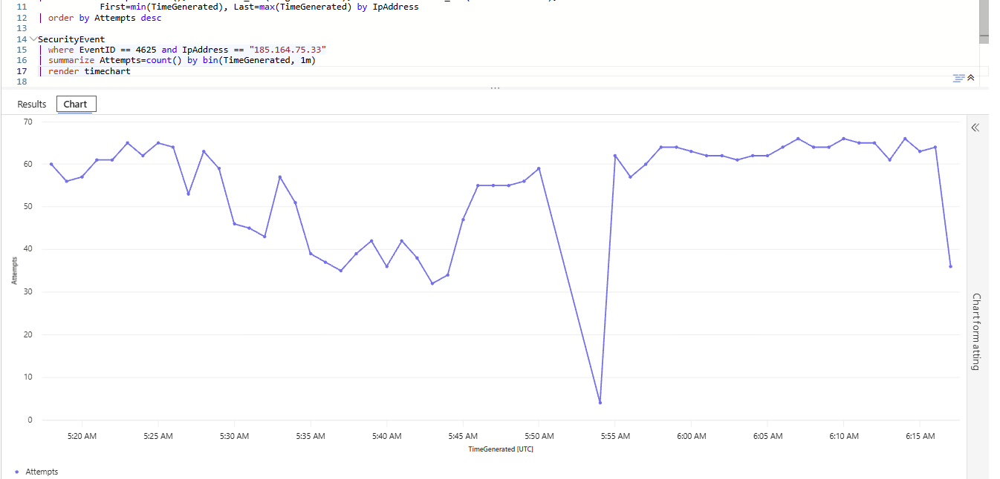

### 3. A broken wordlist became a fingerprint
The Egypt IP's usernames included `accounts`, `for` and `\\`, which are not account names. They look like **words from a comment line and a `DOMAIN\user` entry split incorrectly** by the tool.

The **same malformed list** appeared from two other IPs in two other countries:
- `223.206.248.189` (Thailand): 775 attempts, plus `DENTAL`
- `2.181.14.127` (Iran): 722 attempts, plus `sa`

Three countries, one broken wordlist: **shared commodity tooling**. These junk usernames were also used to correlate 4776 events (which carry no source IP) back to their 4625 source.

### 4. Reconnaissance used against the target ⭐
NTLM discloses the server's hostname **before authentication**. Two separate behaviors show attackers using that leaked information:

**a) Hostname-derived usernames.** Two IPs started within 4 minutes of each other (2026-11-09 22:00 and 22:04 UTC) and tried the same 14-name list:

`vm`, `honeypot`, `vmadmin`, `honeypotadmin`, `adminvm`, `adminhoneypot`, plus `sql`, `sqlbackup`, `tech`, `support`…

| IP | Country | Attempts |
|---|---|---:|
| 89.248.172.63 | Netherlands | 4,144 |
| 138.226.239.7 | United Kingdom | 4,120 |

These are the VM's hostname, **`vm-honeypot`, split on the hyphen and recombined**.

**b) Hostname reflected as workstation name.** Two IPs set `WorkstationName = vm-honeypot` on **every** attempt (7,603 total):

| IP | Country | Attempts | Usernames |
|---|---|---:|---|
| 103.111.211.62 | Indonesia | 3,794 | localized admin names, `userzzz`, `anon3209402` |
| 58.27.212.93 | Pakistan | 3,809 | localized admin names, `USER` |

**Verified, not assumed:** Windows can fill in its own name in some logon paths, so this was checked. Only these 2 of 130 sources showed the value, all events were LogonType 3 / `NtLmSsp`, and both used the same localized username set. The value was attacker-supplied, most likely copied from the NTLM challenge.

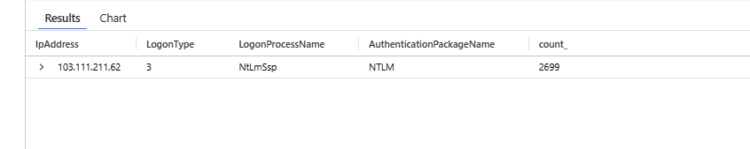
*Taken when the first source was seen; the second source appeared later with identical characteristics.*

### 5. One attacker changed strategy three times
`78.46.176.17` (Germany): **90,102 attempts, 10,037 distinct usernames**.

| Phase (UTC) | Distinct users / hour | Behavior |
|---|---:|---|
| 11-07 17:00 → 11-08 07:00 | 7–10 | Password guessing on common names |
| 11-08 08:00 → 16:00 | 1–2 | Focused on single accounts |
| 11-08 17:00 → 11-09 06:00 | **~1,050–1,150** | **Username spraying**: ~1 attempt per username |
| 11-09 08:00 → end | 7 | Back to password guessing |

Its hourly rate also climbed steadily from ~700 to ~1,630. The pattern maps to **T1110.001 → T1110.003 → T1110.001**.

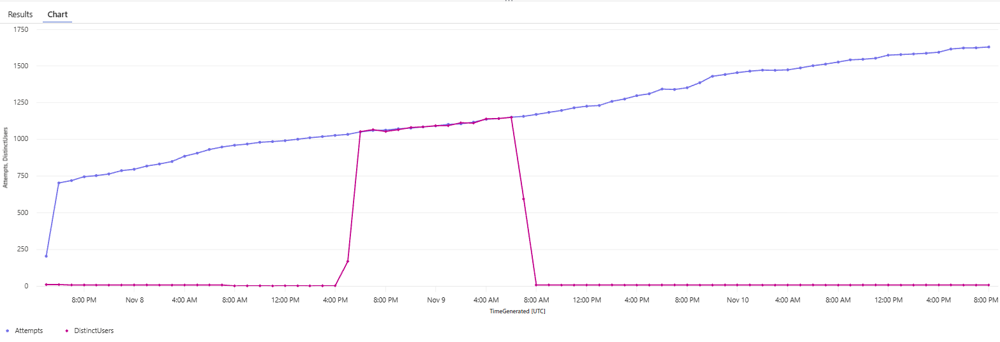

### 6. A low-and-slow swarm that a volume threshold misses
From 2026-11-09 ~22:40 UTC, **68 different IPs** began trying `Administrator` with the same fake workstation name, lowercase `workstation`. Each sent only **1–54 attempts**, spaced out over hours. Concurrent sources per hour jumped from ~10 to ~30 and stayed there.

All 68 together sent only **590 attempts**, so **none** crossed the ≥100-attempt threshold in Rule 1. This is a deliberate evasion pattern, and a detection gap (see [Detections](#detections)).

### 7. Attacker tooling fingerprints
`WorkstationName` is **attacker-controlled** and can't be trusted as identity, but it clusters activity by tool:

| WorkstationName | Source IPs | What it suggests |
|---|---:|---|
| `-` (blank) | 43 | High-speed tools that omit the field (98% of all attempts) |
| `workstation` | 68 | Distributed low-and-slow swarm (Finding 6) |
| `vm-honeypot` | 2 | Target hostname reflected back (Finding 4b) |
| `MSTSC` | 4 | Spoofs the Windows RDP client; only tries `Test` |
| `FreeRDP`, `Rdesktop` | 1 each | Open-source RDP clients |
| `WIN-XXXXXXXXXXX` (4 values) | 4 | Default hostnames of freshly built Windows machines |
| `RX2`, `PROTOWER25`, `HRSERVER`, `SERVERWEB` | 1 each | Real or default hostnames of the source machines |
| `SERSSPOXXDTQXRY` | 1 | Randomized to resist fingerprinting |

### 8. No compromise
| Check | Result |
|---|---|
| 4624 (successful logon) for any named account from an external IP | **None** |
| 4624 from external IPs at all | 5 `ANONYMOUS LOGON` NTLM null sessions from 4 IPs. Credential-less handshakes used for fingerprinting, granting no user access |
| 4672 / 4688 tied to attacker sources | None |
| Lockouts (4740) | 1: built-in `Guest`, after ~10 bad passwords from `189.223.183.200` |

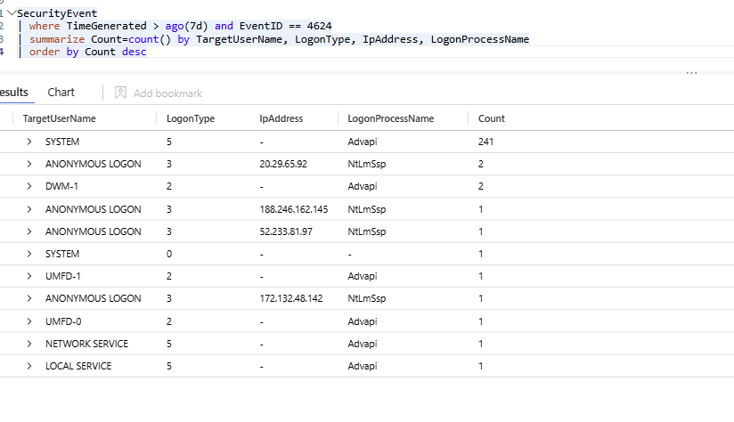

**Correlating 4776 to 4625.** 4776 (credential validation) records no source IP. For `189.223.183.200`, the events were paired by username, workstation (`RX2`) and a ±2-second window. `Administrator` and `Admin` returned *no such user*, while `Guest` went from *wrong password* (`0xC000006A`) to *locked out* (`0xC0000234`):

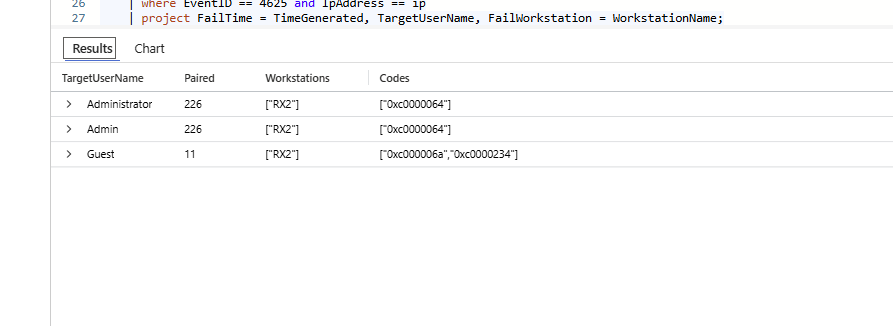

Because the VM's admin account had a **non-default name**, every observed brute-force attempt was aimed at an account that does not exist. The attack could not succeed **regardless of password strength**.

<!-- TODO before publishing: confirm zero attempts on the real admin name:
SecurityEvent | where EventID == 4625 and TargetUserName =~ "<admin-name>" | count -->

---

## Detections

Custom scheduled analytics rules in Microsoft Sentinel.

| Rule | Data | MITRE | Severity | Result |
|---|---|---|---|---|
| **Honeypot - RDP brute force** | `SecurityEvent` 4625, ≥100 attempts per source IP | T1110 Brute Force (T1110.001) | Medium | **33 alerts → 33 incidents**, one per source IP with ≥100 attempts. Exactly matches the 33 qualifying sources in the data |
| **Entra - Member added to privileged role** | `AuditLogs`, `OperationName has "member to role"` | T1098 Account Manipulation (T1098.003) | High | **3 incidents** from one PIM activation (20 alerts from overlapping lookback windows, grouped into those incidents) |

<details>
<summary>Rule 1 query</summary>

```kql
SecurityEvent
| where EventID == 4625
| summarize Attempts = count(), Accounts = make_set(TargetUserName, 10),
            DistinctUsers = dcount(TargetUserName),
            FirstSeen = min(TimeGenerated), LastSeen = max(TimeGenerated) by IpAddress, Computer
| where Attempts >= 100
```
Entities: IP → `IpAddress`, Host → `Computer`.
</details>

<details>
<summary>Rule 4 query</summary>

```kql
AuditLogs
| where OperationName has "member to role"
| extend Actor = coalesce(tostring(InitiatedBy.user.userPrincipalName), tostring(InitiatedBy.app.displayName))
| mv-apply tr = TargetResources on (
    summarize Role = take_anyif(tostring(tr.displayName), tostring(tr.type) == "Role"),
              TargetUser = take_anyif(tostring(tr.userPrincipalName), tostring(tr.type) == "User"))
| project TimeGenerated, OperationName, Actor, TargetUser, Role, Result
```
Entities: Account → `TargetUser`, Account → `Actor`.
</details>

### Tuning notes
- **Threshold:** sources ranged from 1 to 274,399 attempts. A threshold of ≥100 captures the 33 sources responsible for nearly all volume and ignores one-shot scanners.
- **Duplicate alerts:** the first simulation projected **~625 alerts/day**, because a multi-day lookback on an hourly schedule re-detected the same ~26 sources every run. Fixed with 24-hour suppression during backfill, entity-based alert grouping, and a lookback equal to the run frequency for steady-state operation.
- **Rule 4 grouping:** one activation produced 3 incidents because each audit event has a different actor (requester, approver, PIM service). Grouping by target user only would merge them into one.
- **Gap:** the 68-IP `workstation` swarm (Finding 6) evades a per-IP threshold. A complementary rule should count **distinct source IPs per username or per WorkstationName** over a longer window.

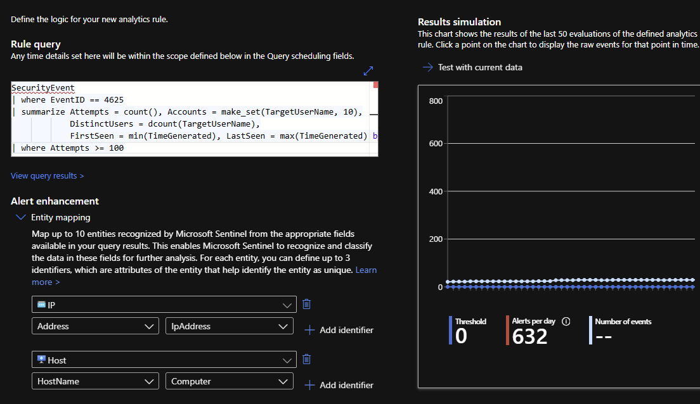
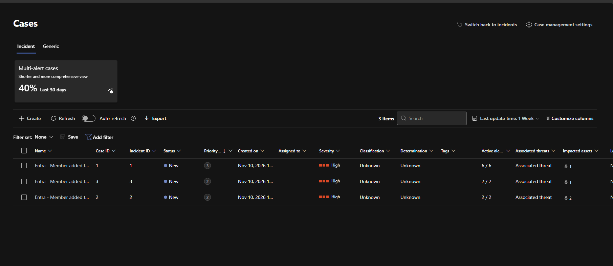
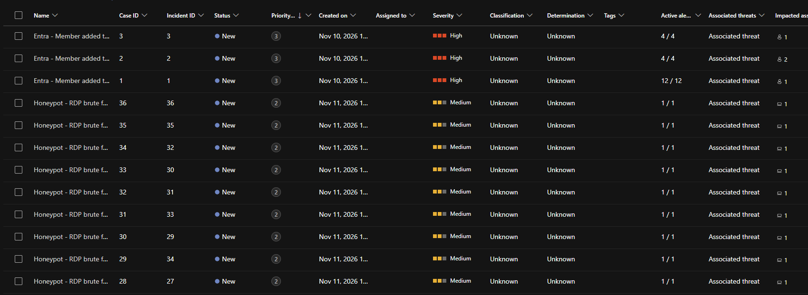

---

## Hardening

| | Before | After |
|---|---|---|
| `DANGER-AllowAnyInbound` (priority 100) | Any → Any, all ports | **Deleted** |
| `rdp` (priority 1000, auto-created with the VM) | TCP 3389 from **Any** | TCP 3389 from **one trusted IP** |
| Exposure | Entire internet | Single admin IP |

The second rule matters: deleting the obvious honeypot rule alone would still have left RDP open to the internet through the rule Azure created automatically.

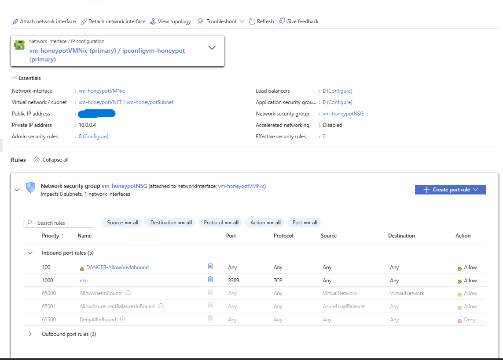
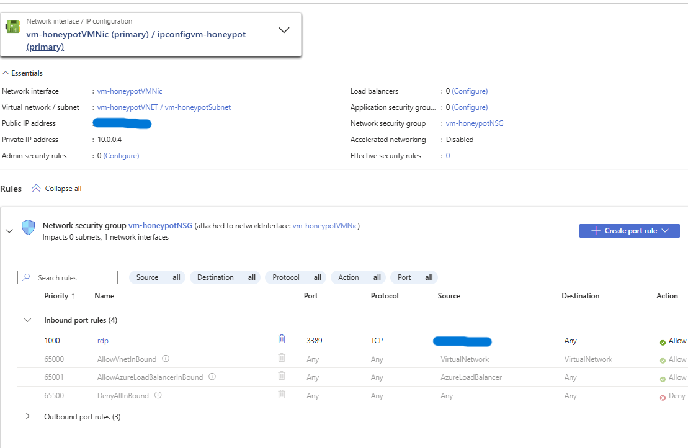

**Production alternatives:** Azure Bastion (no public RDP at all) or Defender for Cloud just-in-time VM access.

---

## Lessons learned
1. **Non-default admin names neutralize most brute force.** 98.9% of 431K attempts went to accounts that did not exist.
2. **Reputation is not enough.** The top attacker had a clean reputation score and a government-registered IP.
3. **NTLM leaks the hostname before authentication**, and attackers use it (Findings 4a and 4b). Don't expose RDP/NTLM to the internet.
4. **Correlate across event types.** 4776 has no source IP, so it was tied back to 4625 using username, time and the attacker's own wordlist mistakes.
5. **Volume thresholds miss distributed attacks.** Detections need both per-source and cross-source logic.
6. **Report-only first** for Conditional Access, and keep a break-glass account excluded.
7. **Entra roles ≠ Azure RBAC.** A Global Administrator can't manage Azure resources without an RBAC role.
8. **Audit every rule with source = Any**, including ones created automatically by tools.

---

## Limitations
- **Geolocation is approximate**, and an IP's location or owner is not the attacker's identity.
- **WorkstationName is attacker-supplied** and can be spoofed; it's used only to cluster activity.
- **RDP vs SMB:** with Network Level Authentication, failed RDP logons are recorded as LogonType 3 / NTLM, the same as SMB. NSG flow logs would be needed to separate them by port.
- **Short window:** ~4 days from a single region and a single VM.
- Interpretations (compromised host, shared tooling, relay botnet) are **behavioral inferences** stated with that confidence, not confirmed attribution.
- No active interaction with attacker infrastructure; enrichment used **passive OSINT only** (AbuseIPDB, WHOIS/ipinfo).

---

## Exam objective mapping

| Exam | Objective | Where in this lab |
|---|---|---|
| AZ-900 | Resource groups, regions, subscriptions | Architecture |
| AZ-900 | Azure Policy, cost management / budgets | Governance |
| AZ-900 | Azure RBAC, network security groups | Identity, Hardening |
| SC-900 | Entra ID identities, groups, roles | Identity |
| SC-900 | MFA, Conditional Access, Zero Trust | Conditional Access |
| SC-900 | PIM, Identity Governance | PIM |
| SC-900 | Microsoft Sentinel (SIEM), KQL, incidents | Findings, Detections |

---

## Evidence files

All exports are from `law-seclab` (KQL in Microsoft Sentinel).

| File | Contents |
|---|---|
| [`evidence/query_data.csv`](evidence/query_data.csv) | All 130 attacking IPs: attempts, usernames, workstation, first/last seen, country |
| [`evidence/topcountries.csv`](evidence/topcountries.csv) | Attempts and IPs per country |
| [`evidence/topusername.csv`](evidence/topusername.csv) | Top 50 usernames with SubStatus |
| [`evidence/timeline.csv`](evidence/timeline.csv) | Hourly attempts and active IPs |
| [`evidence/botnet.csv`](evidence/botnet.csv) | The ~3,100-attempt relay cluster |
| [`evidence/egypt.csv`](evidence/egypt.csv) | Hourly activity for 163.121.35.2 |
| [`evidence/spraying.csv`](evidence/spraying.csv) | Hourly distinct users for 78.46.176.17 |
| [`evidence/recon.csv`](evidence/recon.csv) | Sources reflecting the VM hostname |
| [`evidence/workstationfingerprint.csv`](evidence/workstationfingerprint.csv) | WorkstationName clusters |
| [`evidence/nocompromise.csv`](evidence/nocompromise.csv) | All successful logons (4624) |
| [`evidence/eventsummary.csv`](evidence/eventsummary.csv) | Count per Security Event ID |
| [`evidence/audit.csv`](evidence/audit.csv) | PIM activation audit chain |

---

*Lab resources were deleted after analysis. Credentials, tenant identifiers, subscription IDs and the administrator's own IP address are intentionally excluded.*
